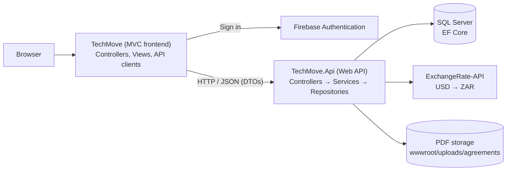

# TechMove Logistics Management System

A full-stack logistics management system for managing **clients, contracts, signed PDF agreements and service requests**. The application is split into an **ASP.NET Core MVC frontend** and a separate **RESTful ASP.NET Core Web API backend**, with Firebase Authentication, live USD-to-ZAR currency conversion, automated tests and a three-container Docker Compose setup.

> Built by **Moegammad Yaaseen Alexander** for Programming 3A (BCIS, Emeris). Final result: **89% (Distinction)**.

---

## Table of Contents

- [Features](#features)
- [Architecture](#architecture)
- [Tech Stack](#tech-stack)
- [Project Structure](#project-structure)
- [Business Rules](#business-rules)
- [API Endpoints](#api-endpoints)
- [Getting Started](#getting-started)
- [Configuration](#configuration)
- [Running the Tests](#running-the-tests)
- [Future Improvements](#future-improvements)
- [Author](#author)

---

## Features

- **Client management:** create, view, edit and delete clients (name, contact details, region).
- **Contract management:** contracts linked to clients, with start and end dates, service level and status (`Draft`, `Active`, `Expired`, `OnHold`).
- **Signed agreements:** upload a signed PDF agreement for each contract and download it later. Only `.pdf` files are accepted, and each file is saved under a unique GUID name.
- **Service requests:** service requests linked to contracts, with a description, cost and status (`Pending`, `Approved`, `Rejected`, `Completed`).
- **Live currency conversion:** costs are entered in **USD** and converted to **ZAR** using a live rate from ExchangeRate-API. The rate used is stored on each request so historical costs stay accurate.
- **Authentication and roles:** sign-in with **Firebase Authentication** (email and password), with `Admin` and `User` roles. Admins can filter contracts by status and date range.
- **Session-based access control:** every page requires a signed-in session. The session times out after 30 minutes of inactivity.
- **Swagger UI** for exploring and testing the API.
- **Docker Compose** setup that runs SQL Server, the API and the MVC frontend together.

---

## Architecture



The solution follows a layered design:

| Layer | Responsibility |
|---|---|
| **MVC frontend** (`TechMove`) | Razor views, session handling, role checks. Talks to the backend only through typed API clients (`IClientApiClient`, `IContractApiClient`, `IServiceRequestApiClient`). |
| **API controllers** (`TechMove.Api/Controllers`) | REST endpoints. Accept and return DTOs only, never EF entities. |
| **API services** (`TechMove.Api/ApiServices`) | Business logic: validation, mapping between DTOs and entities, currency conversion. |
| **Repositories** (`TechMove.Api/Repositories`) | Data access through Entity Framework Core. |
| **Supporting services** (`TechMove.Api/Services`) | `ContractValidationService`, `CurrencyApiService`, `FileService`. |

Every layer depends on interfaces registered with dependency injection, which keeps the layers loosely coupled and easy to test.

---

## Tech Stack

| Area | Technology |
|---|---|
| Language | C# |
| Frontend | ASP.NET Core MVC (.NET 10), Razor Views, Bootstrap |
| Backend | ASP.NET Core Web API (.NET 10), Swagger / Swashbuckle |
| Database | SQL Server, Entity Framework Core 10 (code-first migrations) |
| Authentication | Firebase Authentication (REST sign-in on the frontend, Firebase Admin SDK on the backend) |
| External API | ExchangeRate-API (live USD → ZAR rate) |
| Testing | xUnit, Moq, `Microsoft.AspNetCore.Mvc.Testing` |
| DevOps | Docker, Docker Compose, GitHub |

---

## Project Structure

```
TechMove-Logistics-Management-System/
├── TechMove/                     # MVC frontend
│   ├── ApiClients/               # Typed HTTP clients that call the Web API
│   ├── ApiDtos/                  # DTOs shared with the API, and login models
│   ├── Controllers/              # Account, Clients, Contracts, ServiceRequests, Home
│   ├── Views/                    # Razor views
│   ├── Dockerfile
│   └── TechMove.slnx             # Solution file (includes all three projects)
├── TechMove.Api/                 # RESTful Web API backend
│   ├── ApiServices/              # Business logic layer
│   ├── Controllers/              # REST controllers
│   ├── Data/                     # ApplicationDbContext
│   ├── DTOs/                     # Request and response DTOs
│   ├── Migrations/               # EF Core migrations
│   ├── Models/                   # Client, Contract, ServiceRequest, enums
│   ├── Repositories/             # Data access layer
│   ├── Services/                 # Validation, currency and file services
│   └── Dockerfile
├── TechMove.Tests/               # xUnit unit and integration tests
└── docker-compose.yml            # SQL Server + API + MVC
```

---

## Business Rules

- A service request **cannot be created for, or moved onto, a contract that is `Expired` or `OnHold`**.
- A contract's **end date cannot be before its start date**.
- Contracts must belong to an existing client; an invalid client ID returns `400 Bad Request`.
- Service request costs must be greater than zero. The ZAR cost is calculated as `CostUSD × rate`, rounded to two decimal places.
- Signed agreements must be **PDF files**; any other file type is rejected.
- The database is migrated automatically when the API starts. It retries up to 10 times, so the API waits for SQL Server to be ready inside Docker.

---

## API Endpoints

Base URL: `https://localhost:7189` (local) or `http://localhost:7189` (Docker). Swagger UI is available at `/swagger`.

### Clients — `/api/clients`

| Method | Route | Description |
|---|---|---|
| GET | `/api/clients` | List all clients |
| GET | `/api/clients/{id}` | Get one client |
| POST | `/api/clients` | Create a client |
| PUT | `/api/clients/{id}` | Update a client |
| DELETE | `/api/clients/{id}` | Delete a client |

### Contracts — `/api/contracts`

| Method | Route | Description |
|---|---|---|
| GET | `/api/contracts?status=&startDateFrom=&endDateTo=` | List contracts, with optional filters |
| GET | `/api/contracts/{id}` | Get one contract |
| POST | `/api/contracts` | Create a contract |
| PUT | `/api/contracts/{id}` | Update a contract |
| PATCH | `/api/contracts/{id}/status` | Change a contract's status |
| POST | `/api/contracts/{id}/agreement` | Upload a signed PDF agreement |
| GET | `/api/contracts/{id}/agreement` | Download the signed agreement |
| DELETE | `/api/contracts/{id}` | Delete a contract |

### Service Requests — `/api/service-requests`

| Method | Route | Description |
|---|---|---|
| GET | `/api/service-requests` | List all service requests |
| GET | `/api/service-requests/{id}` | Get one service request |
| POST | `/api/service-requests` | Create a service request (converts USD to ZAR) |
| PUT | `/api/service-requests/{id}` | Update a service request |
| DELETE | `/api/service-requests/{id}` | Delete a service request |

### Auth — `/api/auth`

| Method | Route | Description |
|---|---|---|
| POST | `/api/auth/verify` | Verify a Firebase ID token with the Firebase Admin SDK |

---

## Getting Started

### Prerequisites

- [.NET 10 SDK](https://dotnet.microsoft.com/download)
- **Either** SQL Server LocalDB (installed with Visual Studio on Windows) **or** [Docker Desktop](https://www.docker.com/products/docker-desktop/)
- A [Firebase](https://console.firebase.google.com/) project with **Email/Password** sign-in enabled
- A free [ExchangeRate-API](https://www.exchangerate-api.com/) key

### Option 1: Run with Docker Compose (recommended)

1. Clone the repository:
   ```bash
   git clone https://github.com/Moe-Alex/TechMove-Logistics-Management-System.git
   cd TechMove-Logistics-Management-System
   ```
2. Add your Firebase service account key at `TechMove.Api/firebase-service-account.json` (see [Configuration](#configuration)).
3. Create a `.env` file next to `docker-compose.yml` with your own values, and reference them in the compose file:
   ```env
   MSSQL_SA_PASSWORD=YourStrong!Passw0rd
   EXCHANGE_RATE_API_KEY=your-exchange-rate-api-key
   FIREBASE_WEB_API_KEY=your-firebase-web-api-key
   ```
4. Build and start all three containers:
   ```bash
   docker compose up --build
   ```
5. Open the app:

   | Service | URL |
   |---|---|
   | MVC frontend | http://localhost:7139 |
   | Web API (Swagger) | http://localhost:7189/swagger |
   | SQL Server | `localhost,1433` |

### Option 2: Run locally with Visual Studio or the .NET CLI

1. Open `TechMove/TechMove.slnx` in Visual Studio 2026 (or any IDE with the .NET 10 SDK), or use the CLI.
2. Set your secrets with [user secrets](https://learn.microsoft.com/aspnet/core/security/app-secrets) (see [Configuration](#configuration)).
3. Start the **API** first, then the **MVC frontend**:
   ```bash
   dotnet run --project TechMove.Api --launch-profile https   # https://localhost:7189
   dotnet run --project TechMove --launch-profile https       # https://localhost:7139
   ```
   The API creates the `TechMoveDb` database and applies migrations on first run.

### Signing in

Roles are assigned by email address in `AccountController`:

| Role | Email |
|---|---|
| Admin | `admin@gmail.com` |
| User | `user@gmail.com` |

Create these two users in your Firebase project (**Authentication → Users → Add user**), then sign in on the login page.

---

## Configuration

Keep secrets out of source control. Use **user secrets** locally and **environment variables** (or a `.env` file) in Docker. Add `firebase-service-account.json`, `.env` and `appsettings.*.local.json` to `.gitignore`.

### Web API (`TechMove.Api`)

| Key | Description |
|---|---|
| `ConnectionStrings:DefaultConnection` | SQL Server connection string. Defaults to LocalDB: `Server=(localdb)\MSSQLLocalDB;Database=TechMoveDb;Trusted_Connection=True;TrustServerCertificate=True` |
| `ExchangeRateApi:BaseUrl` | `https://v6.exchangerate-api.com/v6` |
| `ExchangeRateApi:ApiKey` | Your ExchangeRate-API key |
| `firebase-service-account.json` | Firebase Admin SDK key file (Firebase console → Project settings → Service accounts → Generate new private key). Place it in `TechMove.Api/`. **Never commit it.** |

```bash
cd TechMove.Api
dotnet user-secrets init
dotnet user-secrets set "ExchangeRateApi:ApiKey" "your-exchange-rate-api-key"
```

### MVC frontend (`TechMove`)

| Key | Description |
|---|---|
| `ApiSettings:BaseUrl` | URL of the Web API, e.g. `https://localhost:7189/` |
| `Firebase:ApiKey` | Firebase **Web API key** (Firebase console → Project settings → General) |

```bash
cd TechMove
dotnet user-secrets init
dotnet user-secrets set "Firebase:ApiKey" "your-firebase-web-api-key"
```

In Docker, use double underscores for nested keys, e.g. `ExchangeRateApi__ApiKey`, `ConnectionStrings__DefaultConnection`, `Firebase__ApiKey`.

---

## Running the Tests

The `TechMove.Tests` project contains **17 xUnit tests**:

| Test class | Type | What it covers |
|---|---|---|
| `ContractValidationServiceTests` | Unit (4) | Service requests allowed for `Draft`/`Active`, blocked for `Expired`/`OnHold` |
| `CurrencyApiServiceTests` | Unit (3) | USD → ZAR conversion, zero amounts, rounding to two decimal places |
| `FileServiceTests` | Unit (3) | Valid PDF upload, rejected file types, missing file |
| `ApiIntegrationTests` | Integration (7) | Real HTTP calls through `WebApplicationFactory`: list endpoints, 404 for missing contracts, create-then-read, invalid client, end date before start date |

```bash
dotnet test TechMove.Tests
```

> The integration tests start the real API and use the `DefaultConnection` database, so they need SQL Server LocalDB (Windows) or a reachable SQL Server. To run only the unit tests:
> ```bash
> dotnet test TechMove.Tests --filter "FullyQualifiedName!~ApiIntegrationTests"
> ```

---

## Future Improvements

- Assign roles through Firebase custom claims instead of hard-coded email addresses.
- Require a verified Firebase ID token on every API request, not only on `/api/auth/verify`.
- Restrict CORS to the frontend's origin instead of allowing any origin.
- Store signed agreements in cloud storage (e.g. Azure Blob Storage) instead of the API's local file system.
- Run the integration tests against an in-memory or containerised database so they run on any CI runner.
- Add a GitHub Actions workflow that builds the solution and runs the test suite on every push.

---

## Author

**Moegammad Yaaseen Alexander**
BCIS in Application Development, Emeris (formerly IIE MSA)
[LinkedIn](http://www.linkedin.com/in/moegammad-yaaseen-alexander) · [GitHub](https://github.com/Moe-Alex)
